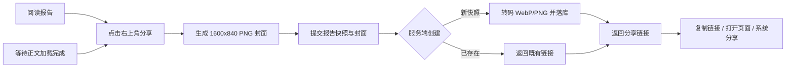

# 每日热点报告分享正式方案

> - 日期：2026-11-12
> - 状态：方案定稿，未实施
> - 范围：macOS 客户端、`starcat-sharing-api`、公开分享页
> - 依赖：现有每日热点报告数据、本地程序化封面、sharing-api 部署链路

---

## 1. 结论

为每日热点报告新增独立分享能力，但**不复用**现有 Repo 分享的 `/api/v1/share` 数据模型。sharing-api 新增 DailyRadar 专用端点：

```http
POST /api/v1/daily-radar/shares
```

客户端提交报告快照与本地生成的 PNG 头图；服务端统一转码为 WebP，并保留 PNG fallback。公开访问路由新增：

```http
GET /d/{id}
GET /d/{id}/hero.webp
GET /d/{id}/hero.png
```

核心决策：

1. 分享的是**不可变报告快照**，绑定 `report_id + content_language + revision`。
2. 头图由客户端复用当前 `DailyRadarCoverView` 的程序化封面渲染，不要求服务端重写 SwiftUI Canvas 算法。
3. 客户端不直接编码 WebP；本机已验证当前 ImageIO 支持写 PNG/JPEG，但 `CGImageDestinationCopyTypeIdentifiers()` 不包含 WebP。因此客户端上传 PNG，由 sharing-api 统一转 WebP。
4. `hero_url` 不进入本次分享链路。它保留为未来日报发布管线的 CDN 封面契约；当前分享资产必须由 sharing-api 自己持有，避免外部 URL 失效。
5. 不修改现有 `/s/{id}` Repo 分享，不迁移、不删除已有 `shares` 表。

---

## 2. 背景与现状

### 2.1 客户端现状

- 每日热点阅读页固定头部在 `Starcat/Features/DailyRadar/DailyRadarPreviewReader.swift`。
- 右上角已有关闭按钮；分享入口应放在关闭按钮左侧。
- `DailyRadarCoverView` 是首页、往期与阅读页共用的本地封面入口，能稳定还原报告分类对应的程序化视觉。
- 当前阅读页封面由本地 Canvas 绘制，未消费 `hero_url`。

### 2.2 服务端现状

- `starcat-sharing-api` 已有 `/api/v1/share`，面向 Repo 与 AI 摘要。
- 已有公开路由 `/s/{id}`。
- 当前 SQLite schema 只有 `shares` 表，尚无版本化迁移机制。
- 新能力需要独立表与独立路由，避免把 DailyRadar 的 markdown、revision、头图资产塞进 Repo 分享模型。

### 2.3 分享需求

用户希望把某篇每日热点报告分享给未安装 Starcat 的人。接收方打开链接后，应直接看到完整报告、头图、相关 GitHub 项目与来源，不需要登录，也不需要理解 Starcat 的内部数据结构。

---

## 3. 产品目标与非目标

### 3.1 目标

1. 在每篇报告详情页提供固定、可发现、不遮挡阅读的分享入口。
2. 生成公开 Web 分享页，适配桌面与移动端。
3. 分享内容与报告 `revision` 精确绑定，避免后续报告更新导致链接内容漂移。
4. 头图使用 WebP 降低常规访问流量，保留 PNG 保证 crawler 与旧浏览器兼容。
5. 公开页展示相关 GitHub 项目、来源链接、Starcat 品牌与安装引导。
6. 旧 Repo 分享能力零回归。

### 3.2 非目标

1. 不做微信、微博、小红书等平台 SDK 接入。
2. 不把用户 Stars、笔记、标签、API Key、账号信息或阅读记录上传。
3. 不为当前分享链路强行启用 `hero_url`。
4. 不实现编辑已分享内容；快照不可变。
5. 不在本期实现二维码导出、长图导出、访问统计报表。
6. 不把公开页默认开放搜索引擎索引；质量稳定后再评估。

---

## 4. 用户流程

### 4.1 分享流程



### 4.2 入口规则

- 位置：阅读页顶部固定栏右侧、关闭按钮左侧。
- 形态：icon-only `square.and.arrow.up`，稳定按钮尺寸，不随加载状态跳动。
- 可用条件：报告正文与 metadata 已加载完成；缓存中的本地报告也允许分享。
- 禁用态：保留可聚焦，Tooltip / accessibility label 说明“报告加载完成后可分享”。
- 加载态：按钮内显示小进度，不允许重复提交。
- 失败态：Sheet 内提供重试，并引导到服务配置；不暴露 operation ID、类名、路径或 transport internals。
- Focus Ring：遵守项目 `.buttonStyle(.plain)` + `.focusEffectDisabled()` 规范。

### 4.3 分享 Sheet

点击入口后打开小型 Sheet，不直接触发系统分享面板。

Sheet 内容：

1. 头图预览：展示即将公开的封面效果。
2. 状态区：生成中 / 已生成 / 失败。
3. 操作区：
   - `复制链接`：使用既有复制反馈规范。
   - `打开分享页`：默认浏览器打开。
   - `系统分享`：调用系统分享服务。
4. 说明：明确公开链接展示的是报告快照，不包含个人数据。

复制链接作为微信、iMessage、邮件等渠道的通用保底，不引入平台 SDK。

---

## 5. API 设计

## 5.1 创建分享

```http
POST /api/v1/daily-radar/shares
Authorization: Bearer {sharing-api-token}
Content-Type: multipart/form-data; boundary=...
```

multipart 字段：

| 字段 | 类型 | 必填 | 说明 |
|---|---|---:|---|
| `request` | JSON part | 是 | 报告快照与相关项目 |
| `hero` | binary part | 是 | 1600x840 PNG，客户端渲染 |

`request` 结构：

```json
{
  "report": {
    "id": "daily-radar-report-id",
    "date": "2026-11-12",
    "categoryId": "openclaw",
    "language": "zh-Hans",
    "revision": "content-revision",
    "title": "OpenClaw 生态日报 2026-11-12",
    "subtitle": "读懂今日动态，发现值得关注的项目。",
    "summary": "报告摘要",
    "readingMinutes": 8,
    "markdown": "完整 markdown 正文",
    "sources": [
      {
        "title": "来源标题",
        "url": "https://example.com/source"
      }
    ]
  },
  "projects": [
    {
      "owner": "example",
      "repo": "project",
      "name": "project",
      "description": "项目描述",
      "language": "Swift",
      "stars": 1000,
      "avatarUrl": "https://avatars.githubusercontent.com/u/1"
    }
  ]
}
```

服务端校验：

1. `report.id`、`language`、`revision`、`title`、`markdown` 必填。
2. markdown ≤ 1 MB。
3. `projects` ≤ 100 条，每条只允许 GitHub owner/repo 与展示字段。
4. sources ≤ 200 条，仅允许 `http` / `https`。
5. 头图必须解码成功、尺寸为 1600x840、PNG 格式、≤ 3 MB。
6. multipart 总大小 ≤ 5 MB。
7. 创建端点复用现有 Bearer auth，并增加 per-token rate limit。

成功响应：

```json
{
  "shareId": "abc123defg",
  "shareUrl": "https://share.example.com/d/abc123defg",
  "alreadyExists": false,
  "heroWebpUrl": "https://share.example.com/d/abc123defg/hero.webp",
  "heroPngUrl": "https://share.example.com/d/abc123defg/hero.png",
  "createdAt": "2026-11-12T08:00:00Z"
}
```

### 5.2 幂等与冲突

唯一键：`report_id + content_language + revision`。

- 首次创建：生成新 share id，写入快照与资产。
- 重复分享：直接返回既有链接，`alreadyExists=true`。
- 同三元组但 `content_hash` 或 `hero_hash` 不同：返回 `409 CONFLICT`，不覆盖旧分享。

这样能保证同一个链接永远指向同一份内容，也避免客户端重复点击造成重复资产。

### 5.3 错误语义

| 状态 | 错误码 | 场景 |
|---|---|---|
| `400` | `BAD_REQUEST` | JSON、multipart、字段或 URL 非法 |
| `401` | `UNAUTHORIZED` | 缺少或错误 Bearer token |
| `409` | `SHARE_CONFLICT` | 同 revision 快照内容不一致 |
| `413` | `PAYLOAD_TOO_LARGE` | markdown、图片或 multipart 超限 |
| `415` | `UNSUPPORTED_MEDIA_TYPE` | 头图不是 PNG 或尺寸不符 |
| `429` | `RATE_LIMITED` | 创建频率超限 |
| `500` | `INTERNAL_ERROR` | 存储、转码等内部失败 |
| `503` | `SERVICE_UNAVAILABLE` | 依赖暂不可用 |

客户端只展示可恢复文案，不透出内部错误细节。

---

## 6. 头图与 WebP 策略

## 6.1 生成方式

客户端将 `DailyRadarCoverView` 离屏渲染为 1600x840 PNG：

- 比例 1.9048:1，适配 `summary_large_image`。
- 保留当前程序化封面风格，不把标题烧入图片。
- 标题、摘要、分类、时间由分享页 HTML 渲染，保证多语言与字体清晰度。
- PNG 编码使用系统 ImageIO。

## 6.2 为什么不在客户端转 WebP

2026-11-12 在当前 macOS 环境验证：

```text
CGImageDestinationCopyTypeIdentifiers()
webpWritable=false
png=true
jpeg=true
```

因此不能假设 ImageIO 能稳定输出 WebP。为了避免向 macOS App 引入额外编码依赖，采用服务端统一转码。

## 6.3 服务端转码

sharing-api 收到 PNG 后：

1. 解码并校验尺寸、像素上限与文件大小。
2. 转码 WebP：
   - lossy quality 初始值 `0.88`。
   - 优先选择无 cgo 的纯 Go WebP encoder，候选库需通过 license、维护状态、Go 版本、质量与内存测试。
   - 目标大小 200–500 KB。
   - 硬上限 1 MB；超限时降为 `0.84` 再试一次，仍超限则失败，不发布低质量图。
3. 保留 PNG fallback：
   - 使用标准库 PNG encoder。
   - 目标 ≤ 1.5 MB，硬上限 3 MB。
4. 计算原始 PNG、WebP、fallback PNG 的 SHA-256 hash。
5. 原子写入资产目录，全部成功后再提交数据库事务。

页面加载策略：

```html
<picture>
  <source type="image/webp" srcset="/d/{id}/hero.webp">
  
</picture>
```

OG / Twitter meta 使用 PNG fallback，最大化 crawler 兼容性：

```html
<meta property="og:image" content="/d/{id}/hero.png">
<meta name="twitter:card" content="summary_large_image">
```

### 6.4 `hero_url` 边界

`hero_url` 继续定义为未来日报发布管线生成的 CDN 封面地址，不作为当前分享输入。

原因：

1. 当前 `hero_url` 未保证长期可用、不可变、带 hash 与格式契约。
2. 分享页必须保证链接多年后仍可打开。
3. 服务端无法验证一个任意 URL 是否对应当前报告 revision。

未来如果日报发布管线提供 `hero_url + hero_hash + width + height + format`，可以再评估复用 CDN 资产；本方案仍要求分享记录保存 hash 与 fallback。

---

## 7. 存储与迁移

## 7.1 表结构

新增 `daily_radar_shares`：

| 字段 | 说明 |
|---|---|
| `id` | 公开 share id |
| `report_id` | 报告 ID |
| `report_date` | 报告日期 |
| `category_id` | 专题 ID |
| `language` | 内容语言 |
| `revision` | 内容 revision |
| `title` / `subtitle` / `summary` | 快照 metadata |
| `markdown` | 快照正文 |
| `projects_json` | 相关项目快照 |
| `sources_json` | 来源快照 |
| `content_hash` | 报告快照 hash |
| `created_at` | 创建时间 |
| `visit_count` | PV 计数 |
| `last_visited_at` | 最近访问时间 |
| `revoked_at` | 撤销时间，默认 NULL |

新增 `daily_radar_share_assets`：

| 字段 | 说明 |
|---|---|
| `share_id` | 关联分享 |
| `kind` | `hero-webp` / `hero-png` |
| `path` | 本地资产路径 |
| `content_hash` | 文件 hash |
| `bytes` | 文件大小 |
| `width` / `height` | 图片尺寸 |
| `created_at` | 写入时间 |

唯一索引：

```sql
CREATE UNIQUE INDEX idx_daily_radar_share_identity
ON daily_radar_shares(report_id, language, revision);
```

### 7.2 资产目录

```text
data/daily-radar/{shareId}/hero.webp
data/daily-radar/{shareId}/hero.png
```

写入要求：

1. 先写临时文件，再原子 rename。
2. 数据库事务提交失败时清理孤儿文件。
3. 只允许服务进程访问资产目录，不把它当作用户上传目录。
4. 备份策略与 SQLite 数据文件一起纳入。

### 7.3 迁移原则

当前 `shares` 表已有线上数据，不能执行删库重建。实施时引入 `schema_migrations`，并追加：

```text
v2__daily_radar_shares.sql
```

约束：

- 新迁移只使用 `CREATE TABLE IF NOT EXISTS` / `CREATE INDEX IF NOT EXISTS`。
- 不修改旧 `shares` 表。
- 迁移失败必须返回错误并停止启动，不能带半 schema 启动。
- 迁移成功记录版本、耗时与 checksum。

---

## 8. 公开分享页

## 8.1 页面结构

路由：`GET /d/{id}`

桌面结构：

```text
[Header: Starcat / 每日热点]
[Hero: WebP 封面 + 分类 + 日期 + 标题 + 摘要 + 阅读时长]
[Projects: 相关 GitHub 项目卡片]
[Article: 报告正文]
[Sources: 来源列表]
[Footer: Starcat 品牌与下载 CTA]
```

移动结构：

1. 保留同样的信息顺序。
2. Hero 垂直布局，标题换行不超过 3 行。
3. 项目卡片单列。
4. 正文使用 16–18px 正文与充足行高。

### 8.2 内容渲染

- markdown 使用受控 Go renderer（如 goldmark 或等价库）。
- 所有快照字段必须经 HTML template 转义。
- 链接统一 `https`，外链加 `rel="noopener noreferrer"`。
- GitHub 项目卡片显示 owner/repo、描述、语言与 stars 快照。
- 项目 logo 可使用快照中的 `avatarUrl`，加载失败显示首字母圆标，不影响页面可用性。
- 页面不登录、不拉取用户数据、不写 cookie。

### 8.3 视觉基调

- 与当前程序化封面一致：深色、层次、克制的生成式线条。
- Hero 背景用 WebP，前景文字由 HTML 渲染。
- 正文阅读区保持浅色 / 深色跟随系统，避免整页过重。
- CTA 保持在页尾，不做强弹窗。

---

## 9. 缓存、OG 与可观测性

### 9.1 Cache-Control

快照不可变：

```http
Cache-Control: public, max-age=31536000, immutable
```

适用：

- `/d/{id}`
- `/d/{id}/hero.webp`
- `/d/{id}/hero.png`

撤销后：

- 返回 `404` 或 `410`。
- 响应使用 `Cache-Control: public, max-age=60`，避免撤销链接长期被缓存。

### 9.2 OG

```html
<meta property="og:type" content="article">
<meta property="og:title" content="{report title}">
<meta property="og:description" content="{report summary}">
<meta property="og:image" content="{absolute hero png url}">
<meta property="og:image:width" content="1600">
<meta property="og:image:height" content="840">
<meta name="twitter:card" content="summary_large_image">
```

默认：

```html
<meta name="robots" content="noindex, nofollow">
```

后续如开放搜索，需要单独评审内容质量与页面 SEO，再改为允许索引。

### 9.3 指标

服务端记录：

- 创建次数、成功 / 失败 / 幂等命中。
- WebP 与 PNG 响应流量。
- 分享页 PV。
- 转码耗时与输出大小分布。

不记录访问者个人身份，不写跟踪 cookie。

---

## 10. 安全与隐私

### 10.1 不上传的数据

- GitHub token、Starcat API key、sharing-api token。
- 用户 Stars、笔记、标签、分组、阅读记录。
- 本机路径、诊断信息、账号信息。

### 10.2 安全边界

1. 创建 API 必须携带 Bearer token。
2. multipart 与图片解码设置严格大小、像素和超时上限，防解压炸弹。
3. 公开页统一 CSP、`X-Content-Type-Options: nosniff`、Referrer-Policy。
4. markdown renderer 禁用原始 HTML 与危险 URL scheme。
5. 外链展示来源域名，帮助接收方判断可信度。
6. 后续增加管理端撤销能力；撤销只影响后续访问，不篡改历史快照记录。

### 10.3 滥用控制

初始限制：

- 创建：per token 10 次 / 分钟。
- 页面访问：常规网关限流。
- 项目数、来源数、markdown、图片大小全部硬限制。
- 创建日志保留 report identity 与错误码，不保留客户端个人信息。

---

## 11. 实施拆分

### Phase 1：服务端基础

1. 引入 schema migration。
2. 新增 DailyRadar 表与 Store 方法。
3. 接入受控 WebP encoder。
4. 实现 PNG 校验、WebP 转码、fallback 与资产原子写入。
5. 增加单元测试：幂等、冲突、大小、尺寸、hash、失败清理。

### Phase 2：API

1. 新增 `POST /api/v1/daily-radar/shares`。
2. 增加请求、响应 DTO 与错误映射。
3. 增加 rate limit 与 auth 测试。
4. 保持旧 `/api/v1/share` 不变。

### Phase 3：公开页

1. 新增 `/d/{id}`。
2. 实现 markdown 安全渲染。
3. 实现项目、来源、品牌与移动端适配。
4. 增加 WebP/PNG 路由与缓存头。
5. 增加 OG、CSP 与 404/410 测试。

### Phase 4：客户端

1. 阅读页增加分享入口与 Sheet。
2. 复用 `DailyRadarCoverView` 离屏渲染 PNG。
3. 新增分享服务与本地幂等缓存。
4. 接入复制、打开、系统分享。
5. 补齐本地化、错误文案、Reduce Motion 与可访问性检查。

### Phase 5：部署与验收

1. 部署 staging sharing-api。
2. 用真实报告生成分享链接。
3. 验证桌面 / 移动浏览器、OG debugger、WebP 响应与 fallback。
4. 备份 SQLite 与资产目录。
5. 部署 production。

---

## 12. 验收清单

### API

- [ ] 同 `report_id + language + revision` 重复提交返回同链接。
- [ ] 同 identity 不同 hash 返回 409，不覆盖数据。
- [ ] 超大 markdown / 图片被拒绝。
- [ ] 非 PNG 或尺寸错误被拒绝。
- [ ] 未授权请求返回 401。
- [ ] 超频请求返回 429。
- [ ] 旧 Repo 分享接口与 `/s/{id}` 不回归。

### 图片

- [ ] 分享页常规加载 WebP。
- [ ] 不支持 WebP 时加载 PNG。
- [ ] OG 使用绝对 PNG URL。
- [ ] WebP ≤ 1 MB，目标 200–500 KB。
- [ ] PNG fallback ≤ 3 MB。
- [ ] 转码失败不产生半可用分享记录。

### 页面

- [ ] 无登录可打开。
- [ ] 桌面与移动宽度可读。
- [ ] markdown 链接安全，无原始 HTML 注入。
- [ ] GitHub 项目与来源正常展示。
- [ ] 404 / 撤销 / 缓存行为正确。

### 客户端

- [ ] 入口位置固定在关闭按钮左侧。
- [ ] 正文未加载完成时不可提交。
- [ ] 生成中不可重复点击。
- [ ] 成功后复制、打开、系统分享可用。
- [ ] 失败文案可理解并可重试。
- [ ] 不出现任何用户私有数据。

---

## 13. 后续扩展

1. 管理端撤销与分享记录列表。
2. 二维码与报告长图导出。
3. `hero_url` 与日报 CDN 发布管线统一。
4. 项目 logo 转存，保证分享页完全自托管。
5. 匿名访问趋势与热门报告统计。
6. 分享页可选开放搜索引擎索引。
