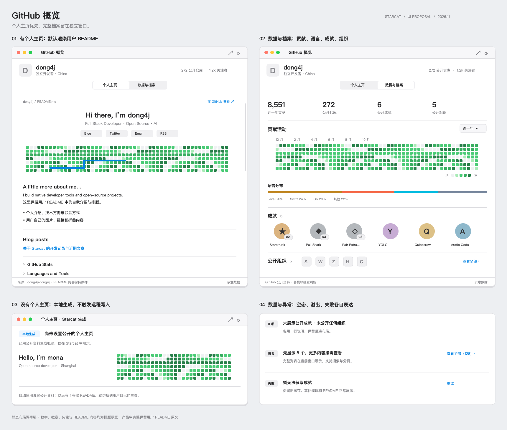
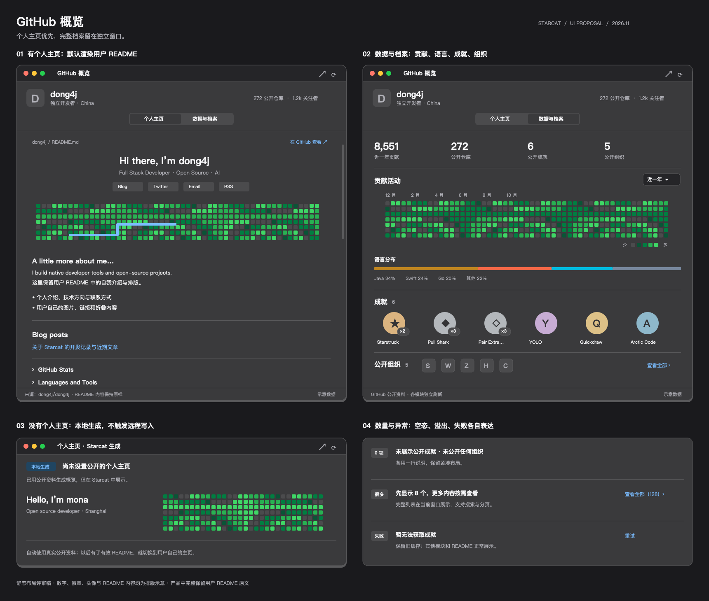

# GitHub 概览最终方案

> 状态：产品方向已确认，最终方案已归档，代码待实施；设计稿为布局参考，不代表实机验收。
>
> 日期：2026-11-13
>
> 适用范围：Starcat macOS App 的 GitHub 概览独立窗口；App Store / Direct 共用产品行为。
>
> 授权范围：本次仅整理方案、归档设计稿及登记决策，不实施功能，不更新主进度总览。
>
> 设计约束：[DESIGN.md](../../../DESIGN.md)、[开发前问题清单](../../1-立项/开发前问题清单.md)。

## 1. 产品定位与范围

点击主窗口左侧现有贡献草坪，打开当前登录用户的「GitHub 概览」独立窗口。窗口集中承载个人主页、贡献活动、语言分布、成就与公开组织。

已有可展示的 Profile README 时，优先展示用户自己维护的内容；没有时，显示 Starcat 内置的默认概览。用户不需要准备模板、配置工作流或学习 Markdown，就能使用这个窗口。

这里的「默认概览」是应用内固定布局与真实用户数据的组合，不生成 GitHub 仓库，不生成需要用户维护的 README 文件，也不增加模板编辑器。

| 本期提供 | 明确不在本期范围 |
|---|---|
| 贡献草坪作为窗口入口 | 在侧栏增加成就、组织或新的常驻信息区 |
| 已有 Profile README 的只读展示 | 创建、修改、提交或推送远端个人主页仓库 |
| 无 README 时的原生默认概览 | README 编辑器、模板市场、拖拽排版、自定义模块配置 |
| 应用内自动检查与手动刷新 | 创建、配置、触发、监控或修复 GitHub Actions |
| 原生贡献、语言、成就与公开组织模块 | 配置远端 Secrets、收集装饰项目专用 Token、扩大 OAuth 权限 |
| 展示用户 README 中已有的装饰图像 | 内置这些装饰项目的运行时，或部署新的统计图片服务 |

「刷新」始终指 Starcat 重新读取远端已经发布的内容。装饰图像由用户自己的工作流或外部服务负责生成，Starcat 不接管它们的生命周期。

## 2. 窗口与信息架构

### 2.1 入口及窗口行为

- 贡献草坪整个区域可点击，提示「打开 GitHub 概览」，提供键盘与辅助功能入口；保留现有侧栏布局与草坪展示。
- 本期只展示当前登录用户，不增加任意用户名搜索或账户对比。
- 同一账户重复点击聚焦已有概览窗口，不叠加重复窗口。
- 使用原生可调整大小的独立窗口，初始内容尺寸建议为 `960 × 760pt`，最低约 `760 × 560pt`；最终以字号倍率、长译文和实机布局验收为准。
- 窗口顶部保留标题、紧凑用户信息、页签、「在 GitHub 查看」和刷新按钮；内容区独立滚动。
- 账户切换时清除旧账户的可见内容与分页状态，再加载新账户；登出后关闭概览窗口。旧请求不得回填到新账户。
- 原生窗口使用系统关闭按钮；不为了关闭窗口额外添加 sheet 关闭控件。

### 2.2 两个页签

| 页签 | 主要职责 | 展示规则 |
|---|---|---|
| 个人主页 | 展示用户自己的介绍与排版 | 有效 Profile README → README 阅读区；未发现可展示主页 → 原生默认概览 |
| 数据与档案 | 展示可比较、可解释的结构化资料 | 贡献活动、语言分布、GitHub 成就、公开组织 |

首次打开默认进入「个人主页」。同一窗口切换页签保留各自滚动位置和已加载内容；普通状态更新不得重建整页。

成就和组织统一放在「数据与档案」，不再进入主窗口左侧面板，也不强行插入用户 README。窗口头部只放头像、用户名、简短简介及少量资料，不另建一条占用宽度的内部侧栏。

### 2.3 已有个人主页

主体尽量保留用户 README 的内容顺序、文字、图片、表格、链接和折叠区块。Starcat 负责阅读环境、基础样式和资源地址处理，不替用户改写正文或重新拼装装饰卡片。

README 来源用一行轻量说明表示，例如 `dong4j/dong4j · README.md`；提供查看原始 GitHub 页面入口。外链按现有 README 路由处理，页内锚点继续在当前文档定位。

不直接嵌入整个 GitHub 网站页面，避免把网站导航、登录态和布局一起搬进应用。读取并渲染 README 的方案沿用项目既有 WebView 决策。

### 2.4 无个人主页时的默认概览

默认概览使用 SwiftUI 固定布局，直接绑定现有资料与贡献数据，不经过 Markdown 模板生成流程。

建议内容顺序：

1. 轻量来源说明：「当前显示 Starcat 默认概览」。
2. 用户头像、名称、`@login`、简介和已有公开链接；字段不存在就自然收起。
3. 公开仓库数、关注者、正在关注、近一年贡献等可用统计。
4. 近一年贡献草坪。
5. 「查看数据与档案」入口，切换到另一页签。

页面不显示「创建个人主页」「选择模板」「生成 README」等操作，也不使用 AI 补写用户简介。README 检测失败时显示失败状态，不能伪装成已经确认无主页。

用户后来在 GitHub 建立有效主页，下一次成功检查后就在「个人主页」页签切换为 README；不切换用户正在浏览的其他页签。

### 2.5 数据与档案的布局

采用单列主阅读区与轻量分区，不做卡片瀑布流：

1. 紧凑统计行：近一年贡献、公开仓库数、关注者、正在关注。
2. 贡献活动：近一年草坪；可复用现有贡献分项数据。
3. 语言分布：水平比例条、语言名和百分比。
4. 成就：徽章网格、名称与来源明确的等级标记。
5. 公开组织：头像、组织名称及展开入口。

成就和组织的数量放在各自标题旁，不重复占用顶部统计行。数量未知时不显示 `0`；组织只完成部分分页时不显示伪造的总数。

首版贡献范围固定为现有服务提供的近一年，不增加历史年份选择器、3D 视角或第二套草坪动画。

## 3. Profile README 的识别

### 3.1 判定依据

GitHub 官方对 Profile README 的主要条件是：仓库与用户名同名、仓库公开、根目录有 README，且 README 有内容。旧仓库还存在需要在 GitHub 手动启用展示的历史情形。[S1]

Starcat 因此区分「检测到可展示的个人 README」与「已证明 GitHub 网站一定展示了该 README」，不把同名仓库存在当作唯一条件。

### 3.2 读取顺序

1. 从当前登录身份获取权威 `login`，检测 `{login}/{login}`。
2. 读取仓库元数据，确认公开状态与实际默认分支；不硬编码 `main` 或 `master`。
3. 读取 README 元数据，检查路径和内容。仓库 README API 选中的文件若在 `.github/` 或 `docs/`，不能仅凭该结果认定存在根目录 Profile README。
4. 条件满足后读取 GitHub 渲染的 HTML，并按仓库、分支和 README 路径解析相对资源。
5. 保留内容身份、响应验证信息和成功检查时间，供下一次刷新复用。[S2]

### 3.3 页面状态

| 检测结果 | 展示行为 |
|---|---|
| 公开同名仓库，根目录 README 有有效内容 | 展示用户 README |
| 仓库不存在、没有根目录 README、明确为空或仓库非公开 | 显示默认概览；文案用「未发现可展示的公开个人主页」 |
| 以前没有主页，现在检测成功 | 刷新后展示 README |
| 以前有主页，后来确认 README 删除、清空或仓库变为非公开 | 移除旧主页展示，切换默认概览 |
| 请求超时、断网、401、限流、5xx | 保留缓存或展示重试，不能缓存为“无主页” |
| 404 无法区分不存在与不可访问 | 只表达“未发现可访问的公开主页”，不声称用户没有同名仓库 |
| 用户改名 | 使用当前身份中的新 `login` 重新检测，不继续固定请求旧仓库名 |

仓库归档不等于 README 失效，公开且仍可读取时继续展示。GitHub 的历史展示开关不由 Starcat 修改；查看 GitHub 原页保留为核对入口。[S1]

## 4. 刷新与缓存

### 4.1 用户交互

工具栏只保留一个刷新入口，语义为「刷新当前页」：

- 「个人主页」显示 README 时：重新检查主页来源、更新正文、重新验证当前页面引用的资源，并刷新共用用户资料。
- 「个人主页」显示默认概览时：重新检查是否出现 Profile README，并刷新默认概览实际使用的资料与贡献数据。
- 「数据与档案」：刷新该页已展示的资料、贡献、语言、成就与组织；不会顺便运行装饰工作流。
- 尚未访问的页签按需加载，不因打开窗口就扫描全部语言或请求全部组织。
- 局部失败提供就地重试；连续点击合并同一轮请求，不排队重复刷新。

刷新统一使用 `SyncIconButton`，包括快速返回或请求被去重时的点击反馈。旧内容在刷新期间继续可读，不以全屏加载遮罩替换。[P1]

### 4.2 正文与资源分别更新

README 文本和引用图片拥有不同的更新周期：

| 变化 | Starcat 应执行的动作 |
|---|---|
| README 正文改变 | 拉取新 HTML，替换正文并尽量保持阅读位置 |
| README 没变，但仓库内 snake / 3D SVG 已更新 | 重新验证该图片资源，更新可变 URL 对应的内容 |
| README 没变，统计服务返回了新图片 | 按图片服务响应更新图片 |
| README 返回 `304 Not Modified` | 继续本轮资源刷新，不能直接认定整页没有变化 |
| 图片服务超时或限流 | 正文继续展示；保留可用旧图或显示局部占位 |
| 链接固定到某个 commit 的图片 | 尊重用户链接，不能擅自替换为默认分支的“最新图” |

正文请求优先使用 `ETag` / `If-None-Match`，可用时辅以 `Last-Modified`；`304` 是正常成功结果。[S2][S3]

资源刷新在既有 README / WebKit 资源加载链路内实现，只作用于当前概览页面。手动刷新要绕过应用自身的新鲜度短路并请求再验证，不能只比较 README SHA 或 HTML 是否相同，也不能靠重建整个应用、清空全部 WebKit 缓存来解决。

不批量给用户图片 URL 拼接随机时间戳，不修改签名参数，不调用 CDN purge。外部服务或 GitHub 图片代理仍可能返回缓存内容；Starcat 不承诺点击刷新后第三方统计一定即时变化。[S4]

现有 WebView 在 HTML 不变时是否会重载子资源、主题切换是否重新选择 `<picture>`，都属于实施验证项，不能把“已有渲染组件”当成已经验证刷新正确。

### 4.3 自动检查策略

采用「缓存先显示、过期后后台检查」，不增加常驻轮询或后台生成任务。

| 数据 | 本期缓存策略 |
|---|---|
| 用户资料 | 复用现有 30 分钟 TTL |
| 贡献草坪 | 复用现有 3 小时 TTL |
| 语言分布 | 复用现有 12 小时 TTL，仅进入数据页后按需加载 |
| README 来源判定及正文 | 新增 30 分钟检查间隔；无主页结果同样到期重查 |
| 公开组织 | 新增 6 小时检查间隔；分页详情按需加载 |
| 成就公开页面结果 | 新增 12 小时检查间隔；失败不写成空集合 |
| 外部图片 | 沿用资源缓存；用户手动刷新时重新验证 |

以上新增间隔是本期初始设计值；不为它们增加设置面板。打开窗口或重新激活时按过期状态检查，窗口关闭后不启动新的轮询。手动刷新跳过本地 TTL，但遵守服务器明确返回的限流与重试时间。

缓存按账户与内容来源隔离。只读快照可重建，不进入 CloudKit，不写入标签、笔记等用户数据表；优先复用现有缓存能力，首版不预设新增数据库迁移。

### 4.4 状态反馈

- 「上次检查」表示成功完成来源检查的时间，不等于图片生成时间。
- 模块保留自己的成功时间和失败状态；某个模块成功不能把其他模块一并标记为最新。
- 有缓存但刷新失败：显示旧内容与简短说明。
- 无缓存且读取失败：显示模块级错误与重试。
- 分页追加失败：保留已经加载的组织，原位置重试，不跳页。

## 5. 成就与组织的边界设计

### 5.1 GitHub 成就的数据边界

这里展示的是 GitHub 个人资料中的 Achievements，不是 Starcat 自创徽章，也不是 Metrics 的自定义成就。

GitHub 官方说明了成就的展示与隐藏方式；本次核验未找到可直接依赖的、官方文档化的 REST / GraphQL 成就读取契约。因此成就按“公开页面尽力读取”的能力设计，不能承诺与官方页面永久同步。[S6]

本期处理原则：

1. 仅读取无需登录的公开成就页面，通过结构化元素识别徽章、名称、链接和页面明确提供的等级。
2. 不借用用户浏览器 Cookie，不访问内部未文档化接口，不增加权限。
3. 解析失败、页面结构变化、登录拦截或访问限制统一进入“暂不可用”，不能返回成功的空数组。
4. 没有足够证据区分“用户隐藏”和“尚未获得”时，文案统一为「未展示公开成就」。
5. 无法稳定提取的字段省略；`×2`、`×3` 等标记只展示来源明确给出的值，不根据贡献量推算。
6. 所有状态都保留「在 GitHub 查看」入口；其他模块不等待成就请求完成。

成就页面解析是本功能最大的外部不确定项。实施时先用真实页面和离线样例验证；若未达到稳定读取条件，保留紧凑的“暂无法获取成就”与外链，不以自创成就或静默隐藏替代，也不宣称完整徽章展示已验收。

### 5.2 公开组织的数据边界

使用 `GET /users/{login}/orgs` 获取公开组织，并遵循响应分页。GitHub 文档明确该用户端点只返回公开组织成员关系。[S5]

不读取 `/user/orgs` 来推导“公开组织”，也不把“我的项目”中的授权组织混入此处。用户已登录不意味着可以将私有成员关系当作公开资料显示。

### 5.3 常见数量与异常状态

| 情况 | 成就 | 公开组织 |
|---|---|---|
| 首次加载 | 一行标题与轻量占位，不预写 `0` | 一行标题与轻量占位，不预写 `0` |
| 确认没有公开内容 | 「未展示公开成就」和外链 | 「未公开任何组织」 |
| 少量 | 正常网格，最多 8 项预览 | 最多 8 个头像，悬停显示名称 |
| 很多 | 标题行提供“查看全部”，在页内展开懒加载网格 | 页内展开组织列表，滚动按需请求下一页 |
| 请求或解析失败 | 旧数据加过期提示；无缓存则显示“暂无法获取成就” | 保留已加载项，提供就地重试 |
| 图片加载失败 | 保留名称与可点击入口，不伪造徽章图案 | 字母或系统占位头像，保留组织名称 |

预览的“8 项”是展示数量，不是数据上限。窄窗口允许自动换行，超过两行时收敛预览数量，完整内容继续通过展开访问。

“查看全部”只在存在更多内容时出现；数量已完整确认时可带总数，否则只显示“查看全部”或“已加载 N 项”。成就数量按不同徽章计数，不把等级倍数累加；组织按稳定 ID 去重，只有分页完成后才显示精确总数。

展开后仍使用当前页面的主滚动区，不新增窗口、sheet 或滚动条套滚动条。首版不增加组织搜索或成就筛选；大量条目由懒加载、分页和收起解决。展开标题整行可点击；远端分页使用项目统一 `ListPaginationPolicy` / `automaticListPagination`。[P2][P3]

组织条目显示头像、名称及 `@login`，长名称单行截断并提供完整提示。点击打开对应 GitHub 组织页；成就点击打开对应成就页，缺少细分链接时打开用户成就页。

## 6. 统计数据的口径

| 模块 | 数据来源与展示约束 |
|---|---|
| 用户资料 | 复用 `UserProfileService`；字段缺失不伪造介绍或数字 |
| 贡献草坪 | 复用 `ContributionService` 与现有 GitHub GraphQL 日历；近一年贡献不改称“全年提交数” |
| 贡献分项 | 复用现有提交、Issue、PR、Review 等字段；以接口口径为准，不强求各分项与日历总数相等 |
| 语言分布 | 复用 `DeveloperLanguageService`，基于本人公开、非 Fork 仓库的语言字节聚合 |
| 成就 | 公开页面明确提供的信息；不可用与零项分开 |
| 组织 | 公开组织成员关系；部分分页与完整总量分开 |

语言分布不表示熟练度或能力排名。正文标明「公开非 Fork 仓库语言分布」；默认显示前 5 种，其余合并“其他”，无语言数据时不画虚假的比例条。

当前语言服务会跳过单个仓库的语言读取失败，且首次加载可能逐仓库请求。概览接入时需要补足部分结果的表达：有失败时标注“基于已获取数据”，不能用已枚举仓库数冒充全部成功数。该模块独立加载，不能阻塞主页首屏或其他区块。

草坪保留 GitHub 实际返回的聚合信息；不展开私有贡献的仓库或事件详情。原生概览不主动把用户 Token 交给第三方统计服务。

## 7. 开源项目评估与使用方式

这些项目用于生成或提供主页装饰内容，并不共同组成一个可直接嵌入的原生 GitHub 资料 SDK。

| 项目 | 主要产物与更新方式 | 本期采用方式 |
|---|---|---|
| `anuraghazra/github-readme-stats` | 统计、语言等图片卡片；服务请求、缓存或自部署策略影响新鲜度 [S7] | 支持用户 README 已引用的图片；不作为原生统计模块的必需服务 |
| `stats-organization/github-stats-extended` | 基于 readme-stats 的扩展统计项目，公开服务同样存在配额与可用性约束 [S8] | 兼容其输出；不部署、不要求用户切换服务 |
| `lowlighter/metrics` | 插件化 SVG 资料，常用 Actions 生成，配置会涉及 Token / Secrets [S9] | 展示用户已生成并引用的 SVG，不运行插件 |
| `yoshi389111/github-profile-3d-contrib` | 工作流生成 3D 贡献 SVG 并提交到仓库 [S10] | 展示已发布的静态或动画 SVG，不增加 3D 原生视图 |
| `Ashutosh00710/github-readme-activity-graph` | 按服务请求生成活动图，也可自行部署 [S11] | 当作普通远程图像展示，允许单图失败降级 |
| `Platane/snk` | 将贡献图生成 SVG / GIF 动画，可由 Actions 定期发布 [S12] | 展示已发布产物，不触发生成或维护输出分支 |

讨论中提到的 `organization/github-stats-extended`，本次核验的实际仓库路径为 `stats-organization/github-stats-extended`。本方案不依赖“原项目已停止维护”或“某个 fork 是官方继任”等判断，选型理由是产物适合展示、生成链路不属于 Starcat。[S7][S8]

Metrics 的 Achievements 插件根据自己的条件与阈值生成徽章，不能拿来冒充 GitHub 官方成就。[S13]

README 本身可以是普通静态文档，不要求 Actions。对于已经引用装饰项目的 README，Starcat 只负责兼容图像格式、资源地址、主题选择和缓存更新；既不自动给用户追加装饰，也不替换用户原有图片服务。

本期不引入上述项目源码、运行时或内置资产，因此不新增相关 SPM / Node / Docker 依赖。以后若实际嵌入第三方代码或静态资源，须另行核验许可证并按项目开源致谢规范登记，不能把“开源”理解为可任意打包。

## 8. README 渲染兼容边界

### 8.1 复用现有能力

复用当前 `readmeHTML`、`ReadmeWebContentView`、`ReadmeAssetURLRewriter` 和样式体系，重点覆盖：

- GitHub 渲染后的 Markdown 与常见 HTML 混排。
- 普通图像、SVG、GIF、徽章及外部统计卡片。
- 相对图片路径、仓库内文件链接和 `<picture>/<source srcset>`。
- `
/
`、表格、长代码块与页内锚点。
- 明暗主题、字号倍率与长内容滚动。

GitHub 渲染 HTML 有助于保持正文语义，但不代表嵌入后与网站逐像素一致。截图、实际 WebKit 行为和远端图片状态仍需验证。

### 8.2 必须保留的约束

- 继续使用现有 CSP 和受控桥接；不执行 README 作者提供的任意脚本，不为了某张装饰卡片开放 iframe 或网页应用运行。
- GitHub API 的授权头只用于受控 API 请求，不传播到 README 外部图片域名。
- 外部图片沿用已有 README 的加载与隐私处理策略；不绕过现有代理主动替换为追踪源。
- 主题切换应响应 `<picture>` 的 `prefers-color-scheme`，而不是只换正文背景；只有一张固定底色图片时保留作者原图，不反色。
- 正文宽度自适应；大图等比缩放，宽表格与代码块在各自区域滚动，不撑宽整个窗口。
- 切换页签和更新统计不重新播放整篇 README；图片失败不拖垮整页。
- 为系统“始终显示滚动条”预留空间，不能遮挡正文、按钮或末尾链接。

SVG 动画、GIF、主题图片和外部卡片逐项验证；本期不承诺支持必须运行第三方 JavaScript 的交互组件。

## 9. 实现边界与复用点

以下是本次源码核对得到的复用位置，不表示概览功能已存在：

| 现有位置 | 已有能力 | 概览接入要求 |
|---|---|---|
| `Starcat/Features/Profile/UserProfileService.swift` | 资料缓存、手动强刷、账户身份检查 | 共用实例，不重复创建账户资料缓存 |
| `Starcat/Features/Profile/ContributionService.swift` | 近一年贡献缓存与刷新 | 复用数据；保留账户切换与关闭行为 |
| `Starcat/Features/Profile/ContributionGraphView.swift` | 现有贡献图表现 | 评估复用可读的静态图部分，不新增动画引擎 |
| `Starcat/Features/Profile/DeveloperLanguageService.swift` | 公开非 Fork 仓库的语言聚合 | 按需加载，明确部分结果 |
| `Starcat/Core/Network/GitHubAPI/ReadmeHTMLAPI.swift` | README HTML / Markdown 与条件请求参数 | 复用读取，补充 Profile 判定与刷新编排 |
| `Starcat/Core/Network/GitHubAPI/ReadmeAssetURLRewriter.swift` | 相对资源及 picture srcset 重写 | 保持仓库、路径和分支上下文 |
| `Starcat/Shared/Components/ReadmeWebView.swift` | README 文档壳、样式、CSP 与资源呈现 | 验证图片独立刷新及主题切换，不复制第二套渲染器 |
| `Starcat/Features/Detail/ReadmeWindowController.swift` | 原生独立窗口、生命周期与标准环境注入 | 参考窗口承载；概览自行保证单账户单窗，不照搬多文档行为 |

新增职责控制在三个范围：

1. **概览窗口与会话**：页签、窗口复用、模块状态、刷新及账户生命周期。
2. **缺失的只读获取**：Profile README 判定、公开组织分页、公开成就解析；沿用现有网络与缓存约定。
3. **原生概览视图**：默认页面、数据页、成就与组织的空态和展开态。

不新建插件平台、模板引擎、通用仪表盘编辑器、统计后端或独立工作流调度器。代码按现有功能目录组织，具体文件拆分在实施时依照职责确定。

独立窗口根视图使用 `.appHostEnvironment(dependencies)` 等标准注入链，包含账户、设置、本地化和字号倍率。仓库 README 已有的翻译、星标历史等附加能力不因复用渲染组件就自动成为 Profile 页功能。

默认布局、列表与工具栏遵循 `DESIGN.md`：系统语义色、紧凑间距、轻量分隔，普通文字和图标只用 `.primary` / `.secondary`，plain Button 使用 `.focusEffectDisabled()`。

新增 UI 文案覆盖实施时 `AppLocale` 与 `locales.json` 确认的全部语言，不复制英语充数；人工审核与 AI 初稿状态分别记录。本次仅写方案，不修改字符串目录。

Swift 学习索引关键词：`@Observable`、`@MainActor`、`Task cancellation`、`NSWindowController`、`WKWebView`；对应代码位置见上表，官方检索词可用 “Swift Observation”“Swift Task cancellation”“WebKit WKWebView”。入口：[Swift 学习索引](../../7-工具与脚本/Swift-学习索引.md)。

## 10. 实施顺序

以下步骤等待明确代码实施授权后执行，本次文档归档不启动实施。

| 阶段 | 工作内容 | 完成条件 |
|---|---|---|
| 1. 窗口与主页 | 草坪入口、两页签、Profile 判定、README 展示、默认概览 | 有 / 无 / 空 / 非公开 / 失败状态均符合方案 |
| 2. 刷新与资源 | 缓存恢复、条件请求、图片独立刷新、主题资源选择 | README 不变而 SVG 更新时可显示新资源；失败保留可用内容 |
| 3. 数据与档案 | 复用贡献和语言，补齐组织分页与成就读取 | 零项、多项、部分数据和不可用状态均可操作 |
| 4. 交付验证 | 针对性回归、双渠道构建、全语言检查、实机验收 | 自动化与人工验收分别留证，不以构建通过代替视觉验收 |

成就公开页面的可靠性验证应尽早进行，避免到最后才发现抓取结果不可用；其失败不阻塞主页、组织和贡献数据的开发，但必须在交付记录中明确能力边界。

## 11. 验收清单

| 场景 | 必须观察到的结果 |
|---|---|
| 重复点击侧栏草坪 | 聚焦同一账户已有窗口，侧栏无成就与组织新增占位 |
| 有效 Profile README | 正文内容、顺序、链接与可支持媒体正确显示 |
| 同名仓库缺少根目录 README | 默认概览正常展示，不把 docs 下 README 当个人主页 |
| README 空白、仓库非公开或不存在 | 显示准确的默认态，不提供远端创建向导 |
| 断网、401、429 / 限流、5xx | 不误判无主页；有缓存时继续可读 |
| 远端 README 修改 | 应用内刷新后显示新正文，没有任何远端写请求 |
| README 未改，snake / 3D 文件更新 | 资源单独刷新，不被正文 `304` 或同 SHA 阻断 |
| 第三方服务仍返回缓存 / 出错 | 不伪造“全部最新”；正文与其他模块正常 |
| 新建或删除个人主页 | 下次成功检查后自动选取 README 或默认概览 |
| 明暗切换与图片 srcset | 正文主题正确，适配图片正确选择，作者固定图片不反色 |
| GIF / SVG 动画与折叠内容 | 在实际 WKWebView 中逐项验证；脚本型组件不擅自开放 |
| 成就隐藏、空页面、解析失败 | 分别按公开内容与可用性表达，失败不显示 `0` |
| 成就很多、名称很长 | 预览收敛，展开后可完整浏览，等级标记不遮挡徽章 |
| 组织超过一页 | 稳定分页、去重、可重试，总数不冒充已完整取得 |
| 组织私有成员关系 | 不出现在“公开组织”中 |
| 语言聚合部分失败 | 其他模块先显示，语言结果带适当的完整性说明 |
| 账户切换、登出、关闭重开 | 无跨账户残留；重复打开不造成重复加载风暴 |
| 窄窗口、大字号、长译文 | 无控件覆盖、字号硬缩小或窗口被内容撑宽 |
| 系统始终显示滚动条 | 文字和交互区域不被滚动条遮挡 |
| 权限与远端副作用 | 不创建仓库、工作流、Secret，不提交 README，不触发 Actions |

实现阶段为 Profile 判定、刷新状态、成就解析及组织分页增加针对性测试；图片缓存与真实 WebKit 展示还需人工验收。构建使用 `make build-appstore` / `make build-direct`，测试使用项目 `make test` 入口，不运行打包或发布脚本。GUI 验证仍按项目约定另行取得授权。

## 12. 设计图

复用本轮讨论中已经产出的明暗布局稿，归档到文档附件目录。图中数字、头像、徽章与 README 文字都是排版示例，不是当前账号数据，也不是最终徽章资产。

布局稿与本最终方案有以下明确对应关系：

- 图中「本地生成 / Starcat 生成」统一解释为「内置默认概览」，正式文案不暗示文件生成或编辑功能。
- 图中的刷新示意符号由项目标准 `SyncIconButton` 替换。
- 图中的成就 / 组织顶部计数移到各自模块标题，统计行采用第 2.5 节的四项资料。
- 「近一年」首版为固定范围，不实现图中示意的范围下拉。
- 图中大量条目示意提到的搜索不纳入首版，采用第 5.3 节的页内展开与分页。

### 浅色布局

### 深色布局

## 13. 核验依据与项目约束

外部资料核验日期为 2026-11-13。以下链接用于说明接口、产物与限制，不表示 Starcat 已完成接入，也不表示外部项目的未来维护与公共服务可用性有保证。

- [S1] [GitHub：Managing your profile README](https://docs.github.com/en/account-and-profile/how-tos/profile-customization/managing-your-profile-readme)。
- [S2] [GitHub REST：Repository contents / Get a repository README](https://docs.github.com/en/rest/repos/contents)。
- [S3] [GitHub REST：Best practices / Conditional requests](https://docs.github.com/en/rest/using-the-rest-api/best-practices-for-using-the-rest-api)。
- [S4] [GitHub：About anonymized URLs / 图片缓存排查](https://docs.github.com/en/authentication/keeping-your-account-and-data-secure/about-anonymized-urls)。
- [S5] [GitHub REST：List organizations for a user](https://docs.github.com/en/rest/orgs/orgs#list-organizations-for-a-user)。
- [S6] [GitHub：Personalizing your profile / Achievements](https://docs.github.com/en/account-and-profile/concepts/personalizing-your-profile)。
- [S7] [anuraghazra/github-readme-stats](https://github.com/anuraghazra/github-readme-stats)。
- [S8] [stats-organization/github-stats-extended](https://github.com/stats-organization/github-stats-extended)。
- [S9] [lowlighter/metrics：Action setup](https://github.com/lowlighter/metrics/blob/master/.github/readme/partials/documentation/setup/action.md)。
- [S10] [yoshi389111/github-profile-3d-contrib](https://github.com/yoshi389111/github-profile-3d-contrib)。
- [S11] [Ashutosh00710/github-readme-activity-graph](https://github.com/Ashutosh00710/github-readme-activity-graph)。
- [S12] [Platane/snk](https://github.com/Platane/snk)。
- [S13] [Metrics：Achievements plugin](https://github.com/lowlighter/metrics/blob/master/source/plugins/achievements/README.md)。
- [P1] [UI 刷新图标规范](../../5-规范/UI-刷新图标-规范.md)。
- [P2] [UI 列表分页加载规范](../../5-规范/UI-列表分页加载规范.md)。
- [P3] [UI 折叠展开规范](../../5-规范/UI-折叠展开-规范.md)。

本专题在实施与验收完成前保持“待实施”状态；不据本方案改动 `docs/功能实现总览.md` 的 checkbox、状态或变更日志。
